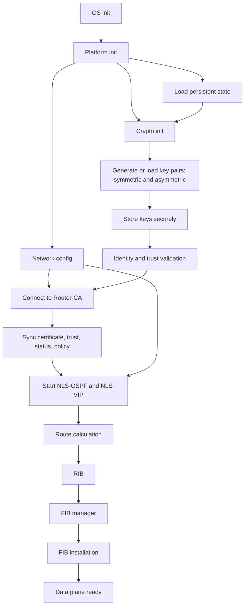

# 01 — Boot Sequence

Status: Draft v0.1.2. Must be reconciled with the actual systemd units and init scripts before acceptance. Markers: **[Specified]**, **[Decision pending]**, **[Not implemented]**.

## 1. Dependency graph

Startup is a dependency graph. Only edges shown are mandatory; unconnected stages may run in parallel.

## 2. Key generation and secure storage

During crypto init the router generates its own **asymmetric (asynchronous)** key pair and its own **symmetric (synchronous)** key material, then stores them in the secure key store (secure hardware where present). Private and symmetric secrets are never logged or exported. Whether existing keys are reused on later boots or regenerated is **[Decision pending]**. Which symmetric material is long-lived versus per-session is decided in the security ADR (`07`). The key pair must exist before Router-CA enrollment because the certificate request is built from the public key.

## 3. Stage table

| Stage | Requires | Produces | On failure |
|---|---|---|---|
| OS and platform init | none | running OS, hardware | halt or reboot per platform policy |
| Network config | platform | interfaces up | per §6 |
| Persistent-state load | platform | configuration, identity and trust metadata | per §6 |
| Crypto init and key generation | platform, database | key pairs stored securely | fail closed for NLS |
| Identity and trust validation | crypto, database | valid or invalid identity | per §5 |
| Router-CA connection | network, identity, keys | authenticated CA session | per §5 |
| CA synchronization | CA session | certificate, trust, key state, authorization policy | per §5 |
| NLS-OSPF and NLS-VIP start | network, valid identity, CA sync per policy | neighbor discovery, VIP exchange ready | per §6 |
| Route calculation, RIB, FIB | NLS-OSPF | forwarding entries | hold previous FIB, retry |
| Data-plane readiness | FIB sync done | forwarding enabled | stay not ready |

## 4. Readiness levels

1. **OS-ready**: OS, platform and management plane up.
2. **Routing-ready**: identity valid per policy, NLS-OSPF and NLS-VIP running, configured adjacency conditions met.
3. **Data-plane-ready**: initial FIB sync acknowledged and forwarding enabled.

Operational means all three. Thresholds are **[Decision pending]**.

## 5. Router-CA connectivity and credential state

- **No valid certificate**: Router-CA is required; NLS does not start. Whether non-NLS routing may run meanwhile is **[Decision pending]**.
- **Valid cached identity, CA unreachable**: allowed only if policy permits, within a maximum cache age **[Decision pending]**; new peers are not authenticated offline by default.
- **Expired certificate**: no new NLS operations; renewal attempted.
- **Revoked identity**: NLS does not start; sessions invalid.
- **Stale revocation data**: policy-driven; fail closed is the recommended default.

## 6. Failure handling

| Failing item | Behaviour |
|---|---|
| Interface | mark down, continue on others, restore on link-up |
| Database | do not start NLS, retry with backoff, never synthesize identity or trust |
| Crypto provider or key store | fail closed for NLS; no protected traffic |
| Router-CA | per §5 |
| NLS-OSPF or NLS-VIP crash | supervisor restarts, reconcile per §7 |
| FIB install | retry, do not mark ready, keep previous entries unless known invalid |

Retry and backoff values are **[Decision pending]**.

## 7. Restart and reconciliation

Installed FIB entries are kept for a bounded stale period after control-plane restart **[Decision pending]**, then full sync reconciles. VIPs, sessions and replay windows are transient and are re-established. Persistent identity and trust metadata is re-validated at load.
